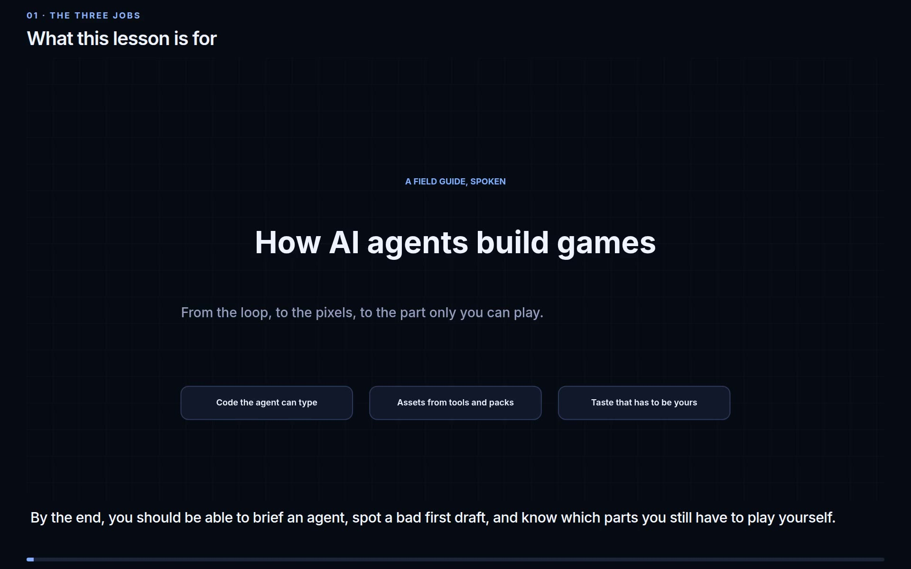

# How AI agents build games

A field guide for an engineer who has not made a game before, and a 24-minute spoken lesson of the same material.

**Read the guide:** [https://connect-world-1985-ai.github.io/2026-10-17-ai-game-building/](https://connect-world-1985-ai.github.io/2026-10-17-ai-game-building/)

**Watch the lesson:** [https://connect-world-1985-ai.github.io/2026-10-17-ai-game-building/watch.html](https://connect-world-1985-ai.github.io/2026-10-17-ai-game-building/watch.html)

The site also opens from disk. Start at [`site/index.html`](site/index.html). Every page works without a server, except the small 3D racer, which loads Three.js from the internet.

[](site/media/how_ai_agents_build_games.mp4)

## The argument

A language model only writes text. A game also needs pictures, sound, and a feeling of control. The agent does most of the typing. Whether the game is fun is still your job.

The spoken lesson draws the joins between the pages: why a fixed timestep is what makes a game testable, why a thin wall gets skipped, what was actually underneath the one-prompt posts, and the order to build a first game. Numbers in the guide were checked on 17 October 2026. Where the lesson recommends rather than reports, the picture says so.

## What is in this repository

| Path | What it is |
| --- | --- |
| [`site/`](site/index.html) | The guide. Sixteen chapters, a glossary, a sources page, and small playable demos. |
| [`site/watch.html`](site/watch.html) | The lesson: video, chapter list, and the full transcript. |
| [`site/media/`](site/media/) | The video (about 44 MB), its poster, and the transcript file. |
| [`docs/memory/`](docs/memory/) | The research notes behind the pages. |
| [`tools/build_sources.py`](tools/build_sources.py) | Regenerates the source list on the sources page after links change. |

## Read it on your machine

Open `site/index.html` in a browser, or serve the folder:

```bash
python -m http.server 8766 --directory site
```

Then open <http://127.0.0.1:8766/>. The lesson is <http://127.0.0.1:8766/watch.html>.

## GitHub Pages

[`.github/workflows/pages.yml`](.github/workflows/pages.yml) publishes the `site/` folder on every push to `main`. The public site root is that folder, so `site/index.html` is the home address above and `site/watch.html` is the lesson address.

The video is one file of about 44 MB. Playback starts when you press play. The player can seek.

The workflow also tries to turn Pages on the first time it runs. If the addresses above say the site was not found, that switch still needs a person: open **Settings → Pages**, choose **GitHub Actions** as the source, and re-run **Publish the guide**. Do not choose the `/docs` folder. That directory holds the research notes, not the site. A `.nojekyll` file is present so a branch deploy serves the HTML as files. The other working branch choice is `main` and the `/` (root) folder.
